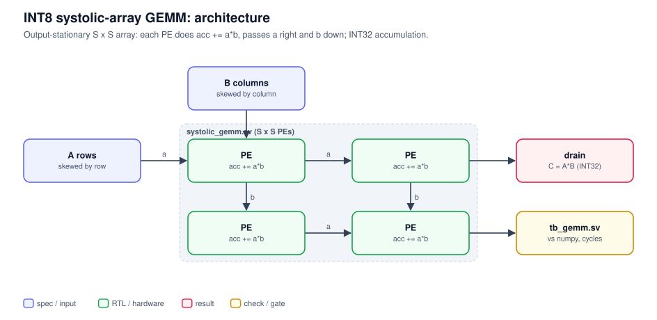
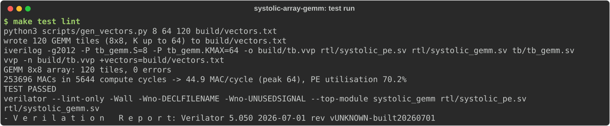

# INT8 systolic-array GEMM accelerator

[](https://github.com/Ana2601/systolic-array-gemm/actions/workflows/ci.yml)

An S×S output-stationary systolic array that computes C = A·B with INT8 operands and INT32 accumulation: the core of a TPU-style matrix engine.

## Architecture



- `rtl/systolic_pe.sv`: one MAC processing element
- `rtl/systolic_gemm.sv`: on-chip A/B operand buffers, skewed edge feeders, the S×S array, and a result read port
- PE(i,j) sees A[i][k] and B[k][j] in the same clock (k = t − i − j); a tile takes **K + 2S − 2** cycles
- Parameterised in S (array size) and KMAX (reduction depth)

## Verification

`scripts/gen_vectors.py` generates tiles with an exact integer reference: random values, all-extreme values (−128/127, the worst-case accumulation), and small/sparse values. K covers 1, 2, S, KMAX−1, KMAX and random. Every C element is checked, and so is the exact cycle count of every tile.

## Results (measured)

| Array | Tiles | Errors | Throughput | PE utilisation |
|---|---|---|---|---|
| 4×4 | 120 | 0 | 11.8 MAC/clk (peak 16) | 73.6 % |
| 8×8 | 120 | 0 | 44.9 MAC/clk (peak 64) | 70.2 % |
| 16×16 | 30 | 0 | 170.1 MAC/clk (peak 256) | 66.5 % |

Utilisation below 100 % is the fill/drain cost (2S − 2 cycles per tile), which this design does not overlap. The table shows it growing with S.

## Run

```bash
make test               # 8x8
make test S=16 KMAX=128 TILES=30
make lint
make synth              # PE-level cells
```

## Test run

Output of the CI command (`make test lint`), captured from a local run:



## Limitations / next steps

Tiles are not double-buffered, so fill/drain is not hidden behind the next tile's load; that is the main utilisation lever. There is no tiling controller for matrices larger than S×S, and no DMA or AXI front end.

## Setup

- [OSS CAD Suite](https://github.com/YosysHQ/oss-cad-suite-build) (Icarus Verilog, Verilator, Yosys)

```bash
make test
make lint
```

The same commands run in CI on every push (`.github/workflows/ci.yml`).
